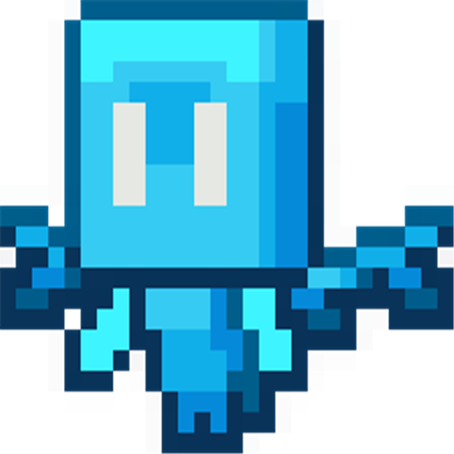
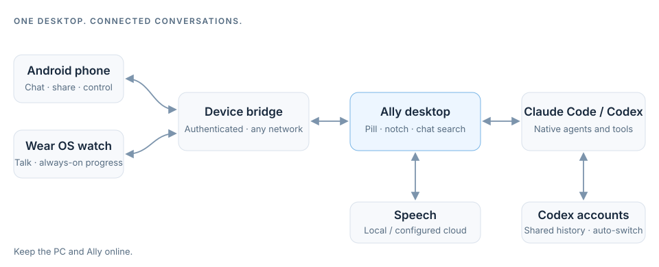

<div align="center">



# Ally

**Your agents. Your conversations. Within reach.**

A floating desktop companion for **Claude Code** and **Codex**, with voice, visual explanations, and connected Android phone and Wear OS apps.

[Website](https://ally-taupe.vercel.app) · [Get started](#quick-start) · [Explore the features](#one-conversation-across-your-devices) · [Documentation](docs/README.md) · [Development](#development)


</div>

---

Ally brings your existing coding agents into a small, always-on-top window. Keep it as a compact glass pill, expand the conversation when you need more room, or continue from your phone or watch. The agents retain their own tools, sessions, working folders, and permissions; Ally handles the interface around them.

Drag the pill to the top edge to dock it into a **notch**, or press `Ctrl+Shift+C`. The notch currently runs on a private local adapter (the `ally-study` submodule, not public); Ally works fully as the floating pill without it, and we're rebuilding the notch as part of Ally. See [Native notch](docs/native-notch.md).

## One conversation across your devices

| | What you can do |
| --- | --- |
| **Desktop** | Switch between Claude Code and Codex, browse and search native sessions, follow live activity, and resize the floating window. Dock the pill into the top notch, where the running reply and Ally's greeting show live. Reopening restores your selected chat and saved draft. |
| **Codex accounts** | Sign in to several ChatGPT accounts. They share one chat history, so when one reaches its usage limit the same chat continues on your next available account — no handoff. |
| **Phone** | Continue the same chats, share text and attachments into Ally, review real approval requests, and open the agent monitor. Hold the power button to talk: Ally suggests a chat, and you confirm or pick another before sending. |
| **Watch** | Hold to talk, browse rich replies and images, switch chats, review supported questions and approvals, and read answers aloud. Always-on display keeps live agent progress visible past the system's return timer. |
| **Voice** | Use local transcription or configured Google Cloud streaming speech. Speak over playback to interrupt it; text remains available when voice is offline. |
| **Circle and draw** | Select a screen region, attach it to your next question, and explore explanations on a movable drawing board with sketch tools and interactive diagrams. |
| **Stay in control** | Keep drafts per chat, queue follow-ups, steer supported active turns, stop work, and return to older replies without losing the latest response. |

### Small window, full context

- **Rich replies:** Markdown, math, code, tool activity, reported usage, and image thumbnails, with supported local visualizations opening in a sandboxed viewer.
- **Useful context:** clipboard and selected-screen attachments, with optional query-time screen attachment controlled by the user.
- **Activity at a glance:** active, unread, stopped, error, and needs-input states across the desktop and companion surfaces. Phone widgets, Quick Settings, and a Wear tile offer quick entry points.
- **A consistent look:** coordinated orb, glow, robot, palette, and appearance settings. The compact reader keeps older answers reachable inside a bounded card.
- **Chat search:** find any conversation by keyword from the sidebar, the notch chat picker, and the assistant's chat selector.
- **Optional integrations:** cross-chat tools, realtime perception, and robot context can extend the agents through their existing interfaces.

## Bring phone context to your desktop

Opt-in **hold-close handoff** uses nearby Bluetooth plus a deliberate three-second hold to open a local screen-context review. Its on/off preference persists; Android service limits still apply. Review the draft, choose a chat and explicitly Send. Original documents can be attached through Android Share or a system file picker; a screenshot does not transfer the entire file.

Structured context distinguishes observed app/URL/document/media fields from unavailable information. Supported original PDFs can include file details and page count. **Large-file transfers** are chunked and resumable — the desktop bridge and Android client both support restart-safe upload with per-chunk and whole-file SHA-256 integrity (100 MB limit, resume from last acknowledged offset).

**Phone control** lets an agent drive your phone through the Ally app's accessibility service, over any network with no ADB. Turn on **Ally control** once in Android's Accessibility settings. One approval starts a timed session for that chat (15 minutes by default); a notification with **Stop** shows while it runs and the screen stays on. If the phone is locked, Ally shows Android's own fingerprint/face/PIN prompt and continues once you unlock. Passwords, payments, permission prompts and Send/Pay/Delete-style buttons are always left to you. The optional read-only scrcpy viewer requires ADB and a separate approval.

**Setup and exact limits:** [Device continuity guide](docs/device-continuity.md) · [Remaining features](docs/device-continuity-backlog.md). Android updates and staged desktop changes have separate deployment states; see the guide before assuming a feature is live.
## Quick start

For development from source, install a current Node.js LTS release with npm and at least one supported agent: **Claude Code** or **Codex**. Sign in to that agent before using it through Ally.

```sh
git clone https://github.com/AryanRai/Ally.git   # the private ally-study submodule is optional
cd Ally/glass-pip-chat
npm ci
npm run dev
```

Then:

1. Open **Settings → Agents** and check the CLI paths and default working folder.
2. Choose Claude Code or Codex in the model menu.
3. Start a chat or select an existing native session.
4. Add voice or companion devices when you need them.

Ally can discover the Codex desktop app’s bundled CLI on supported Windows installations. For chats owned by Codex desktop, the experimental desktop route uses the existing owner when configured; browsing history itself never acquires a writer. Ownership errors do not create an automatic fork.

**Continue with:** [Desktop and voice setup](docs/getting-started.md) · [Phone and watch setup](wear-app/README.md) · [Chat ownership](docs/codex-chat-ownership.md)

## Make Ally your own

Open **Settings → Orb, glow & robot** to change appearance. Previews can simulate activity without opening the microphone or camera. Window dimensions and appearance settings persist, and manual resizing remains available.

Useful desktop shortcuts use **Ctrl** on Windows/Linux and **⌘** on macOS:

| Shortcut | Action |
| --- | --- |
| `Ctrl/⌘ + Shift + C` | Show / hide Ally, or toggle between native notch and floating window |
| `Ctrl/⌘ + Shift + Q` | Open the compact input |
| `Ctrl/⌘ + Shift + Space` | Start Circle selection |
| `Ctrl/⌘ + Shift + M` | Toggle compact / expanded mode |
| `Ctrl/⌘ + Shift + S` | Cycle window size |
| `Ctrl/⌘ + Shift + V` | Toggle voice controls |
| `F1` / `F2` / `F6` | Settings / new chat / sidebar |
| `Ctrl/⌘ + .` | Stop the selected conversation’s work |

Global shortcuts depend on the operating system and can conflict with other applications. The function keys and Stop shortcut apply while Ally is focused.

## How Ally connects



The device bridge listens on loopback. An explicitly configured HTTPS tunnel lets paired devices reach it remotely; development can use an ADB tunnel. **Keep the PC, Ally, and the chosen connection running.** This is a connection to your desktop agents, not an independently hosted cloud agent.

Approvals are real requests from the underlying tool or device, with explicit answers and expiry. Full access does not bypass mandatory confirmations. An automatic review rejection does not create an Allow prompt that Ally can display later.

Microphone and screen access follow the selected feature’s explicit activation and permissions. Audio recordings stay in memory in Ally’s voice path; configured cloud speech sends audio or reply text to that provider. Credentials remain in the desktop’s configuration, and pairing tokens must be kept private. See [voice](docs/voice-and-notifications.md), [device controls](docs/phone-control.md), and [visual context](docs/pill-canvas-workflow.md) for the individual boundaries.

## Development

Run desktop commands from `glass-pip-chat/`:

| Command | Purpose |
| --- | --- |
| `npm run dev` | Start Vite and Electron for development |
| `npm run typecheck` | Check renderer and Electron TypeScript |
| `npm run test:run` | Run the desktop test suite |
| `npm run build:vite` | Build the renderer |
| `npm run build:electron` | Build Electron modules and preload |
| `npm run build` | Build the app and create the platform package |

Platform packaging scripts are also available: `build:win`, `build:mac`, and `build:linux`. Native platform behavior and packaging requirements vary; Windows is the primary verified development environment. Local speech has a separate Python environment, and Android companions have their own Gradle builds.

```text
Ally/
├── glass-pip-chat/       Electron + React desktop application
│   ├── electron/        Agent, speech, device bridge, capture, and window modules
│   ├── src/             Interface, chat state, drawing surfaces, and hooks
│   └── scripts/         Builds, synthetic checks, and performance diagnostics
├── wear-app/
│   ├── app/             Wear OS companion
│   ├── phone/           Android phone companion
│   └── device-common/   Shared Android components
├── speech-service/      Managed local faster-whisper transcription worker
├── ally-study/          Private submodule: local native-notch adapter (not public)
└── docs/                Setup guides, architecture notes, and validation reports
```

Agents working in this repository coordinate through a local ledger (`docs/agent-collaboration.md`, not published) and the relevant feature documentation. Preserve concurrent edits, exact chat identity, user drafts, and active work. Use isolated builds for deployment and coordinate any restart.

## Documentation

Start with the [documentation index](docs/README.md) for setup, daily use, architecture, and troubleshooting.

| Looking for… | Start here |
| --- | --- |
| Desktop, agent, voice, or connection setup | [Getting started](docs/getting-started.md) |
| Android phone and Wear OS builds | [Companion guide](wear-app/README.md) |
| Local transcription and model-cache setup | [Speech worker](speech-service/README.md) |
| Questions, approvals, and device controls | [Interactions](docs/chat-interactions.md) · [Phone controls](docs/phone-control.md) |
| Several Codex accounts and automatic switching | [Codex accounts](docs/codex-accounts.md) |
| The top-edge notch | [Native notch](docs/native-notch.md) |
| Circle, drawing boards, and diagrams | [Pill and canvas](docs/pill-canvas-workflow.md) · [Visualization artifacts](docs/drawing-artifacts-and-phone-approvals.md) |
| Responsiveness and restoring the open chat | [Debugger results](docs/debugger-performance-results.md) |

### Website

The product page at [ally-taupe.vercel.app](https://ally-taupe.vercel.app) is a static site in [`site/`](site/), deployed by Vercel from this repository.

Ally v2 retired its standalone web build, `ally-remote-service`, Supabase sync, Discord integration, browser extension, and earlier in-app model/tool loop. Current agent work goes through Claude Code or Codex. See [the deployment history](docs/vercel-retired-deployments.md).

